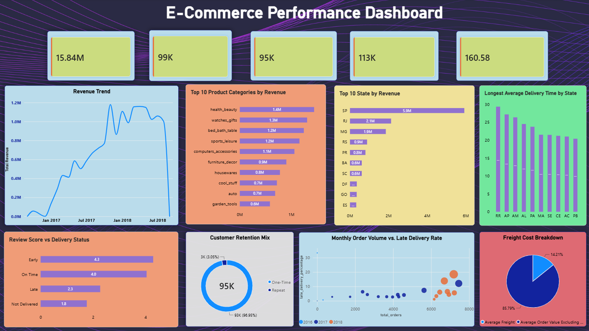

# E-Commerce Data Integration & Analytics Pipeline

An end-to-end e-commerce data engineering and analytics project built using **Python, Pandas, PySpark, and Power BI**. The project transforms raw Brazilian e-commerce transaction data into validated, analysis-ready datasets and uses business analytics to investigate sales performance, customer behavior, seller performance, delivery reliability, and customer satisfaction.

## Dashboard Preview



## Project Overview

The project uses the [Brazilian E-Commerce Public Dataset by Olist](https://www.kaggle.com/datasets/olistbr/brazilian-ecommerce), which contains approximately 100,000 orders from 2016–2018 across customers, orders, products, sellers, payments, reviews, and geolocation datasets.

The workflow covers:

**Raw Data → Inspection & Cleaning → Data Validation → PySpark ETL → Analytical Tables → Business Insights → Power BI Dashboard**

## Tech Stack

- **Programming:** Python
- **Data Processing:** Pandas, PySpark, Apache Spark
- **Analytics:** SQL and business KPI analysis
- **Visualization:** Power BI
- **Development:** Jupyter Notebook, VS Code, Git, GitHub

## Project Structure

```text
Ecommerce Data Pipeline/
├── Data/
│   ├── raw/
│   ├── Processed/
│   └── analytics_ready/
├── Notebooks/
│   ├── 01_data_inspection_cleaning.ipynb
│   ├── 02_cleaned_data_validation.ipynb
│   ├── 03_data_universal_loading.ipynb
│   └── 04_pyspark_etl.ipynb
├── Analytics/
│   ├── Notebooks/
│   │   └── 05_analytics.ipynb
│   ├── Business_Questions/
│   ├── Analytical_Tables/
│   └── Insights/
├── PowerBI/
│   ├── ecommerce_performance.pbix
│   └── dashboard_preview.png
├── Docs/
├── src/
├── output/
├── requirements.txt
├── .gitignore
└── README.md
```

## Data Engineering Workflow

### 1. Data Inspection and Cleaning
- Inspected schemas, data types, null values, duplicates, and unique identifiers.
- Investigated relationships between the source datasets.
- Standardized data types and prepared cleaned datasets for downstream processing.

### 2. Data Validation
- Validated key relationships and dataset consistency.
- Examined missing values and data quality issues.
- Documented table relationships and data inspection findings.

### 3. PySpark ETL
- Integrated the e-commerce datasets using their relational keys.
- Generated an item-level analytical dataset.
- Derived order, delivery, customer, seller, and freight-related features.
- Saved analysis-ready outputs in Parquet format.

### 4. Business Analytics
Developed analytical tables and investigated eight business questions:

1. How does revenue change over time?
2. Which product categories generate the most revenue and orders?
3. Which sellers contribute most to sales?
4. How do repeat customers compare with one-time customers?
5. Which Brazilian states generate the highest revenue?
6. How frequently are orders delivered late?
7. Is delivery performance associated with customer review scores?
8. How significant are freight costs relative to order value?

### 5. Power BI Dashboard
The dashboard presents executive KPIs and visual analyses covering:

- Revenue trends and order volume
- Product category performance
- Geographic sales distribution
- Delivery performance
- Customer satisfaction
- Customer retention
- Freight and order economics

## Key Findings

- **Revenue:** Approximately 15.84 million in total order value across 98,666 orders.
- **Product categories:** Health & Beauty was the highest-revenue category, generating approximately 1.44 million.
- **Customer retention:** Repeat customers represented approximately 3.1% of unique customers and had higher average spend than one-time customers.
- **Delivery:** Approximately 6.62% of orders were delivered late.
- **Customer satisfaction:** Late deliveries were associated with lower average review scores than early deliveries.
- **Freight:** Total freight costs were approximately 2.25 million, representing around 14.21% of total order value.

*Figures are based on the current analytical outputs. Delivery and review findings describe observed associations, not proven causal relationships.*

## Running the Project

1. Download the Olist dataset from the source linked above.
2. Place the source CSV files in `Data/raw/`, following the expected filenames.
3. Install the Python dependencies:

   ```bash
   pip install -r requirements.txt
   ```

4. Configure Java and Hadoop prerequisites for the local PySpark environment as described in the project documentation.
5. Run the notebooks in order, beginning with data inspection and validation, followed by PySpark ETL and business analytics.
6. Open `PowerBI/ecommerce_performance.pbix` to explore the dashboard.

**Note:** Local paths and environment settings may need adjustment for your machine. Google Cloud Platform and Dataproc are potential future extensions, not part of the currently completed implementation.

## Future Improvements

- Automate data quality checks and pipeline execution.
- Optimize Spark processing and storage.
- Deploy the ETL workflow on Google Cloud Dataproc and Google Cloud Storage.
- Add advanced customer segmentation and predictive analytics.

## Author

**Girdhari Kumar**  
B.Tech, Industrial Design | Minor in Computer Science & Engineering  
Interests: Data Analytics, Data Engineering, PySpark, SQL, and Business Intelligence.
